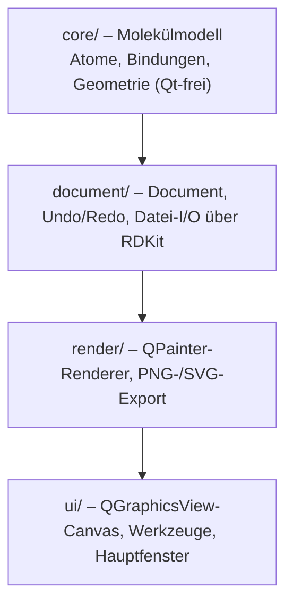

# ValenceDraw

Ein plattformunabhängiger 2D-Struktur-Editor als **native Desktop-Anwendung** (Windows, macOS,
Linux), nicht als Web-App.

> Status: **MVP (Meilenstein 5)** – lauffähiges Fenster, Ethan auf dem Canvas,
> Bindungen zeichnen, Atome setzen, Ring-Templates, Auswahl/Verschieben **aller
> Objekte** (Atome, Texte, Pfeile; Pfeillänge nachträglich änderbar),
> Undo/Redo, **Reaktionspfeile**, **Textbeschriftungen mit Hoch-/Tiefstellung**
> und **LaTeX-Formeln** (`$…$`), **Ladungen** (`+`, `2+` … per Klick),
> **Elektronenpaare als zwei Punkte** und **Radikale** (ein Punkt),
> **Gruppenlabels direkt am Atom** (z. B. NO₂, Fe³⁺), **automatische
> H-Atome an Heteroatomen** (`OH`, `NH₂`, `SH` – Bindungen und Ladungen
> aktualisieren sie sofort), **Keilstrichformeln**
> (Keil/Strichkeil), **Teilladungen δ⁺/δ⁻**, **Farbpalette** (Atome, Bindungen,
> ganze Moleküle, Texte und Pfeile nachträglich einfärben), **Ansatztabelle**
> (Äquivalente, molare Masse, Stoffmenge, Masse, Dichte und Volumen aus der
> Reaktionsgleichung), **A4-/Letter-Blatt mit Hoch-/Querformat**,
> **Projektdatei `.valencedraw`** (speichert auch Texte, Pfeile und Farben),
> **Kopieren/Einfügen** aller Objekte, SMILES/MOL laden & speichern,
> SVG/PNG-Export.

## Schnellstart

```powershell
# 1. Virtuelle Umgebung (falls noch nicht vorhanden)
python -m venv .venv
.\.venv\Scripts\python.exe -m pip install --upgrade pip

# 2. Projekt installieren (inkl. PySide6 + RDKit)
.\.venv\Scripts\python.exe -m pip install -e ".[dev]"

# 3. Starten
.\.venv\Scripts\python.exe -m valencedraw
# oder: .\.venv\Scripts\valencedraw.exe
```

Tests:

```powershell
.\.venv\Scripts\python.exe -m pytest
```

Hilfsskripte (Ergebnisse landen in `out/`):

```powershell
.\.venv\Scripts\python.exe scripts\render_demo.py        # Ethan/Benzol/Ethanol als PNG + SVG
.\.venv\Scripts\python.exe scripts\window_screenshot.py  # Screenshot des Hauptfensters
```

In VS Code startest du die App direkt mit **F5** (Konfigurationen liegen in
`.vscode/launch.json`: „ValenceDraw starten", „ValenceDraw (ohne Debugger)" und
„Tests (pytest)").

## Bedienung

| Aktion | Kürzel / Geste |
| --- | --- |
| Werkzeug Auswahl | `V` |
| Werkzeug Bindung | `B` |
| Werkzeug Keil | `K` |
| Werkzeug Strichkeil | `S` |
| Werkzeug Atom | `A` |
| Werkzeug Ladung | `L` |
| Werkzeug Teilladung | `Shift+L` |
| Werkzeug Elektronen | `D` |
| Werkzeug Ring | `R` |
| Werkzeug Text | `T` |
| Werkzeug Pfeil | `P` |
| Werkzeug Radierer | `E` |
| Atombeschriftung entfernen | Radierer auf ein sichtbares Atom (`O`, `OTs`, geladen …): erster Klick macht es zu einem Skelett-Kohlenstoff, die Bindungen bleiben; zweiter Klick löscht das Atom samt Bindungen |
| Elektronen wegnehmen | Radierer auf ein Elektronenpaar oder Radikal klicken – nur diese Punkte verschwinden, das Atom bleibt unverändert |
| Ladung setzen | Ladungswerkzeug (`L`): Klick auf ein Atom zählt positiv (`+` → `2+` … → `7+` → neutral), Rechtsklick bzw. `Shift`+Klick zählt negativ (`−` → `2−` … → `7−` → neutral) |
| Ladungsposition wählen | Mit dem Ladungswerkzeug die Maustaste auf einem Atom **gedrückt halten** (~0,45 s): im Kreis erscheinen acht mögliche Positionen; Maus in die gewünschte Richtung bewegen, loslassen – danach öffnet sich das Textfeld für die Ladung |
| Ladung eintippen | Doppelklick bzw. `Strg`+Klick mit dem Ladungswerkzeug oder Menü „Werkzeuge“ → „Ladung eingeben…“ (genau ein Atom auswählen) |
| Teilladung setzen | Teilladungswerkzeug (`Shift+L`): Klick auf ein Atom setzt δ⁺, Rechtsklick bzw. `Shift`+Klick δ⁻; ein erneuter Klick mit demselben Vorzeichen entfernt die Teilladung wieder |
| Teilladungsposition wählen | Mit dem Teilladungswerkzeug die Maustaste auf einem Atom **gedrückt halten** (~0,45 s): Ring aus acht Positionen, Maus in die gewünschte Richtung, loslassen |
| Elektronenpaar setzen | Elektronenwerkzeug (`D`): neben ein Atom klicken – die Klickrichtung bestimmt die Position (zwei einzelne Punkte); erneuter Klick auf denselben Punkt entfernt das Paar |
| Elektronenposition wählen | Mit dem Elektronenwerkzeug die Maustaste auf einem Atom **gedrückt halten** (~0,45 s): rund um das Atom erscheinen acht mögliche Positionen, die markierte folgt der Maus – Maustaste loslassen setzt das Elektron dorthin |
| Radikal setzen | Rechtsklick oder `Shift`+Klick neben ein Atom – ein einzelner Punkt (funktioniert auch mit Halten + Position wählen) |
| Bindungsordnung wählen | `1` / `2` / `3` |
| Bindung zeichnen | von Atom zu Atom ziehen (Winkel rastet in 15°-Schritten ein); Doppelbindungen in Ringen werden automatisch nach innen gezeichnet |
| Bindung ohne Ziehrichtung | Klick mit dem Bindungswerkzeug auf ein Atom oder auf das leere Blatt (ohne Ziehen): die Bindung wird automatisch in der günstigsten Richtung angehängt bzw. gesetzt – ~120° zu vorhandenen Bindungen, andere Atome und der Blattrand werden gemieden |
| Bindungsordnung weiterschalten | Klick auf eine Bindung: 1 → 2 (zentriert) → 2 (Linie auf einer Seite) → 2 (andere Seite) → 3 → 1 – mit Auswahl- **oder** Bindungswerkzeug |
| Keilbindung | Keil-Werkzeug (`K`): in die gewünschte Richtung ziehen – die **schmale Spitze sitzt am Startatom**, die breite Seite am Zielatom. Klick auf ein Atom hängt eine neue Keilbindung in der günstigsten Richtung an |
| Strichkeilbindung | Strichkeil-Werkzeug (`S`): wie Keilbindung, aber gestrichelt (Bindung liegt hinter der Zeichenebene) |
| Keildarstellung umwandeln | Klick mit dem Keil- bzw. Strichkeil-Werkzeug auf eine vorhandene Bindung: sie wird zum Keil/Strichkeil (Doppel-/Dreifachbindungen werden dabei zu Einfachbindungen); ein erneuter Klick hebt die Darstellung wieder auf; **Rechtsklick** spiegelt die Spitze an das andere Atom |
| Bindungs-Hover | Über die Bindungsmitte fahren: die Bindung leuchtet blau (nicht über den Atomen/Labels) |
| Bindungsordnung erhöhen | erneut über eine bestehende Bindung ziehen |
| Ring platzieren | Klick auf freie Fläche; Klick auf ein Atom knüpft den Ring dort an |
| Text setzen / ändern | Klick mit dem Text-Werkzeug (Dialog mit Vorschau) |
| Formel setzen | Im Text-Dialog `$…$` verwenden, z. B. `$\Delta G^\circ = -RT \ln K$` (Button **Mathe $…$**) |
| Gruppenlabel am Atom | Klick mit dem Text-Werkzeug auf ein Atom (z. B. `NO2`, `Fe3+`) |
| Wasserstoff anzeigen | Heteroatome zeigen ihre H-Atome automatisch: Bindung an ein `O` → `OH`, eine zweite Bindung oder Doppelbindung → wieder `O`; Ladungen verschieben die Anzahl (`O⁻` ohne H, `OH2+` mit zwei H). Elektronenpaare und Teilladungen ändern nichts |
| Reaktionspfeil | mit dem Pfeil-Werkzeug in die gewünschte Richtung ziehen (Winkel rastet in 15°-Schritten ein) |
| Elektronenfluss-Pfeil | Pfeil-Werkzeug + Auswahl „Paar ↷“ (Elektronenpaar, volle Spitze) oder „Radikal ↷“ (einzelnes Elektron, Fischhaken am Pfeilende) – der Pfeil ist gebogen |
| Auswahl erweitern | `Shift` + Klick |
| Objekt auswählen | Klick mit dem Auswahlwerkzeug auf Atom, Text oder Pfeil |
| Objekte einfärben | Im Auswahlwerkzeug Atome/Texte/Pfeile auswählen (Klick, `Shift`+Klick oder Rechteck), dann in der Leiste **Farbe** auf ein Farbfeld klicken. Bindungen werden mitgefärbt, wenn beide Endatome ausgewählt sind – mit `Strg+A` lässt sich so ein ganzes Molekül einfärben. Der linke Knopf (weiß mit rotem Strich) setzt die Standardfarbe Schwarz zurück |
| Ansatztabelle | Reaktionsgleichung auswählen (am einfachsten `Strg+A`) und **F9** drücken bzw. in der Leiste **Ansatztabelle** anklicken. Die Tabelle erscheint unten: Strukturen links vom Pfeil = Edukte, rechts = Produkte, Texte/Strukturen über dem Pfeil = Reagenzien; Texte unter dem Pfeil (Lösemittel) und `-R`/`−R` (abgehende Gruppen) werden ignoriert. Reagenzien heißen zunächst nur „Reagenz 1“, „Reagenz 2“ … (Name in der Tabelle änderbar) und bekommen **nie** automatisch eine molare Masse. Zahlenwerte in `eq`, `M`, `n`, `m`, `ρ` und `V` lassen sich direkt anklicken und ändern; abhängige Werte werden automatisch neu berechnet. Der Knopf **„LaTeX-Code kopieren“** legt die Tabelle als LaTeX-`tabular` in die Zwischenablage |
| Rechteck-Auswahl | Auf freier Fläche ein Rechteck aufziehen – erfasst alle Atome, Texte und Pfeile darin (`Shift` = zur Auswahl hinzufügen); danach mit der Maus verschieben |
| Verschieben | Auswahl mit der linken Maustaste ziehen – Atome, Texte und Pfeile gemeinsam |
| Pfeil verlängern | Pfeil anklicken, dann an einem der blauen Greifpunkte ziehen (gerade Pfeile rasten in 15°-Schritten ein); Elektronenfluss-Pfeile wandern entlang ihres Kreisbogens weiter – auch über 180° –, sodass die Krümmung erhalten bleibt |
| Pfeilkrümmung ändern | Bei Elektronenfluss-Pfeilen hat der ausgewählte Pfeil einen **mittleren Greifpunkt** auf der Kurve – daran ziehen biegt den Pfeil stärker/schwächer (senkrecht), auf die andere Seite um (Vorzeichen) oder verschiebt den Scheitel nach links/rechts. Wird der Scheitel entlang des Pfeils gezogen, wird der Pfeil asymmetrisch: links und rechts liegen dann zwei Kreisbögen mit unterschiedlichem Radius, die sich im Scheitel tangential treffen |
| Seitenformat | Menü „Seite“ → Format (A4, A3, A5, Letter, Legal) |
| Hoch-/Querformat | Menü „Seite“ → Hochformat / Querformat |
| Scrollen | Zwei-Finger-Wischen bzw. Mausrad: vertikal; horizontal per seitlichem Wischen, `Shift`+Mausrad oder Scrollbar (nur wenn das Blatt breiter als das Fenster ist) |
| Löschen | `Entf` |
| Ausschneiden / Kopieren / Einfügen | `Strg+X` / `Strg+C` / `Strg+V` – nimmt Atome (mit den Bindungen darunter), Texte und Pfeile; Kopien werden versetzt eingefügt und gleich ausgewählt |
| Alles auswählen / Auswahl aufheben | `Strg+A` / `Esc` |
| Undo / Redo | `Strg+Z` / `Strg+Y` |
| Zoom | `Strg` + Mausrad bzw. Pinch-Geste zoomt um den Mauszeiger (die Stelle unter dem Cursor bleibt stehen), `Strg+0` (ganzes Blatt), `Strg+Shift+0` (Blattbreite) |
| Pan | mittlere Maustaste ziehen |
| Datei öffnen/speichern | `Strg+O` / `Strg+S` (`.valencedraw`, `.mol`, `.sdf`, `.smi`) |

### Dateiformate

| Format | Inhalt |
| --- | --- |
| `.valencedraw` (Standard, JSON) | **komplettes Dokument**: Atome, Bindungen, Atomlabels, Ladungen, **Teilladungen**, Elektronenpaare/Radikale, Keil-/Strichkeilbindungen, **Farben**, Texte, Pfeile, Seitenformat und Ausrichtung |
| `.mol` / `.sdf` / `.smi` | nur Atome und Bindungen (Chemie-Austausch über RDKit) – Texte, Pfeile, Atomlabels, Teilladungen und Farben gehen beim Speichern verloren; das Programm warnt vorher |

Beim Öffnen erkennt ValenceDraw das Format an der Dateiendung. Die Projektdatei ist
reines JSON und damit gut lesbar bzw. versionierbar; unbekannte Versionen werden
mit einer Fehlermeldung abgelehnt.
| Einstellungen | Menü „Bearbeiten“ → „Einstellungen…“ (`Strg+,`) |

## Einstellungen

Der Dialog **Bearbeiten → Einstellungen…** (`Strg+,`) öffnet ein Fenster mit
Tabs; aktuell gibt es den Reiter **Bindungen**:

| Einstellung | Bereich | Wirkung |
| --- | --- | --- |
| Bindungslänge | 1,0 – 20,0 mm (Standard 4,0 mm) | Länge **neu** gezeichneter Bindungen und neu platzierter Ringe |
| Bindungsdicke | 0,05 – 2,00 mm (Standard 0,30 mm) | Strichdicke aller Bindungen und Pfeile, sofort sichtbar |

Eine Live-Vorschau (Benzolring) zeigt die Einstellung direkt im Dialog.
Bestehende Strukturen behalten ihre Koordinaten – die Bindungslänge bestimmt
nur, wie groß neue Bindungen und Ringe gezeichnet werden.

## Text, Atomlabels und Reaktionspfeile

**Text** wird mit dem Text-Werkzeug (`T`) gesetzt. Im Dialog gibt es eine
Live-Vorschau und Buttons für die Auszeichnung der aktuellen Auswahl
(hoch-/tiefgestellt, fett, kursiv):

| Eingabe | Ergebnis |
| --- | --- |
| `H_2O` | H₂O (nur das nächste Zeichen tiefgestellt) |
| `SO_4^{2-}` | SO₄²⁻ (Gruppe in `{…}`) |
| `Fe^{3+}` | Fe³⁺ |
| `**fett**` | **fett** |
| `*kursiv*` | *kursiv* |
| `**SO_4^{2-}**` | fett inklusive Tief-/Hochstellung |
| `A\_B` | literales `A_B` |
| `$\Delta G^\circ$` | ΔG° als LaTeX-Formel (siehe unten) |

Für Fett und Kursiv gibt es im Dialog die Buttons **Fett** und **Kursiv**; sie
umschließen die aktuelle Auswahl mit `**…**` bzw. `*…*` und heben die
Auszeichnung beim erneuten Klick wieder auf. Beides lässt sich mit
Hoch-/Tiefstellung kombinieren und gilt auch für Gruppenlabels an Atomen.

Zusätzlich übersetzt die **automatische Chemiker-Schreibweise** gängige
Notationen ohne Markup: Ziffern direkt nach Buchstaben oder Klammern werden
tiefgestellt, eine abschließende Ladung hochgestellt.

| Eingabe | Ausgabe |
| --- | --- |
| `NO2` | NO₂ |
| `(CH3)2CO` | (CH₃)₂CO |
| `NO3-` / `NH4+` | NO₃⁻ / NH₄⁺ |
| `Ca2+` / `Fe3+` | Ca²⁺ / Fe³⁺ |

### LaTeX-Formeln

Text zwischen `$…$` wird als Mathematik gelesen. Der Quelltext bleibt im
Dokument (und in der `.valencedraw`-Datei) erhalten – gerendert wird beim
Zeichnen, Exportieren und in der Dialog-Vorschau. Der Button **Mathe $…$** im
Text-Dialog setzt die Markierung um die Auswahl (nochmal klicken hebt sie auf).

| Eingabe | Ergebnis |
| --- | --- |
| `$\Delta G^\circ = -RT \ln K$` | ΔG° = −RT ln K |
| `$K_s = \frac{[A^-][H^+]}{[HA]}$` | K_s = [A⁻][H⁺]/[HA] (Brüche einzeilig, Summen bekommen Klammern) |
| `$\sqrt{x^2+y^2}$` | √(x²+y²) |
| `$\mathrm{kJ\,mol^{-1}}$` | kJ mol⁻¹ |
| `$A \rightleftharpoons B$` | A ⇌ B |
| `$\alpha_1 + \beta^{2-}$` | α₁ + β²⁻ |
| `$\mathbf{fett}$` / `$\mathit{kursiv}$` | **fett** / *kursiv* |
| `$\bar{x}$`, `$\hat{y}$`, `$\vec{v}$` | x̄, ŷ, v⃗ (kombinierende Akzente) |
| `\$ 5` | literales `$ 5` (nicht als Formel) |

Unterstützt werden unter anderem:

* **griechische Buchstaben** – `\alpha` … `\omega`, `\Gamma` … `\Omega`
* **Symbole** – `\cdot`, `\times`, `\pm`, `\infty`, `\partial`, `\sum`,
  `\int`, `\approx`, `\neq`, `\leq`, `\geq`, `\rightarrow`, `\Rightarrow`,
  `\rightleftharpoons`, `\ldots` …
* **Strukturen** – `^`/`_` (auch `^{…}`), `\frac{a}{b}`, `\sqrt{x}`,
  `\sqrt[3]{x}`, `\left( … \right)`, `\overline{…}`
* **Schrift** – `\mathrm{…}`, `\text{…}`, `\mathbf{…}`, `\mathit{…}`
* **Abstände** – `\,`, `\;`, `\quad`, `\qquad`

Ein Bruch wird einzeilig gesetzt (`a/b`), weil ein gestapelter Bruch in einer
Textzeile die Zeilenhöhe sprengen würde; bei Summen ergänzt der Übersetzer
automatisch Klammern. Unbekannte Befehle erscheinen als Text, eine Formel ohne
schließendes `$` bleibt unverändert stehen.

**Gruppenlabels am Atom**: Mit dem Text-Werkzeug auf ein Atom klicken – der
Dialog öffnet sich mit dem bereits gesetzten Label. Das Label ersetzt die
Standardbeschriftung (Element + Ladung) und wird wie freier Text gerendert,
inklusive Hoch-/Tiefstellung; Bindungen enden automatisch am Labelrand – mit
runder Kappe, nicht gerade abgeschnitten. Gruppenlabels sitzen dabei genauso
dicht an der Bindung wie Elementlabels (die Label-Box umschließt die
tatsächliche Tintenfläche des Textes), und ein kleiner Abstand
(`Style.bond_label_gap`) hält Bindung und Text auseinander. Endständige Labels
(etwa `OTs`) werden seitlich bzw. über/unter das Atom gesetzt – nicht schräg
nach unten –, sodass der Text auf der Höhe des Bindungsendes bleibt. Bei
senkrechten Bindungen steht das erste Zeichen eines mehrbuchstabigen Labels
mittig über der Bindungsachse (z. B. `NH` → Bindung unter dem `N`), ein
einzelnes Elementsymbol bleibt mittig. Ein leeres Label entfernt die
Beschriftung wieder. Alles ist undo-fähig.

**Wasserstoffatome** zeichnet das Programm an Heteroatomen automatisch – sie
stehen nicht im Modell, sondern ergeben sich beim Zeichnen aus der Summe der
Bindungsordnungen und der typischen Valenz (`valencedraw.core.valence`). Ein
`O` am Bindungsende wird dadurch zu `OH`, ein `N` zu `NH₂` (im Ring `NH`); eine
zweite Bindung, eine Doppelbindung oder ein ausdrücklich gezeichnetes H nimmt
das Bindungsvermögen weg, das Label wird wieder zum reinen Elementsymbol.
Formalladungen verschieben die Valenz um eine Stufe: `O⁺` mit einer Bindung
zeigt `OH₂⁺`, `O⁻` dagegen `O⁻` ohne H. Elektronenpaare, Radikale und
Teilladungen bleiben ohne Einfluss. Freie, ungebundene Atome behalten ihr
Elementsymbol (ein einzelnes `O` ist keine Formel `OH₂`), und Kohlenstoff
bleibt beim Skelett ohne H-Angabe. Ein eigenes Gruppenlabel ersetzt den
H-Anhang vollständig.

**Ladungen** setzt das Ladungswerkzeug (`L`): Ein Klick auf ein Atom zählt die
positive Ladung hoch (`+` → `2+` → … → `7+` → neutral), ein Rechtsklick – oder
`Shift`+Klick – die negative (`−` → `2−` → … → `7−` → neutral). Ist das Atom
entgegengesetzt geladen, springt der Zyklus auf die erste Stufe der neuen
Richtung (`2−` + Klick → `+`).

Die Obergrenze `MAX_ATOM_CHARGE = 7` deckt Permanganat ab (in MnO₄⁻ ist Mn
**+7**, nicht +6). Höhere formale Ladungen (z. B. IrO₄⁺ mit +9) trägt man über
den Eingabedialog ein – Doppelklick bzw. `Strg`+Klick mit dem Ladungswerkzeug
oder Menü „Werkzeuge“ → „Ladung eingeben…“ (Spinbox `−7 … +7`).

**Ladungsposition wählen**: Die Maustaste auf einem Atom gedrückt halten –
nach ~0,45 s erscheint ein Ring aus acht Positionen um das Atom. Die markierte
Position folgt der Mausrichtung; beim Loslassen öffnet sich das **Eingabefeld**
für die Ladung (Startwert: aktuelle Ladung, bei neutralen Atomen `+1` bzw. `−1`).
Erst wenn man bestätigt, wird Ladung **und** Position in einem Undo-Schritt
gesetzt – Abbrechen ändert nichts. Ohne gewählte Position landet die Ladung
wie bisher in der freien Ecke, die am weitesten von den Bindungen weg ist; die
gewählte Richtung wird in der `.valencedraw`-Datei gespeichert (`charge_at`).
Das gleiche Bedienmuster wie bei den Elektronenpaaren.

Wichtig: **Die Ladung verändert die Struktur nicht.** Sie wird als eigenes,
kleineres Zeichen neben das Atomlabel gesetzt – in die freie Ecke, die am
weitesten von den Bindungen weg ist (bei einem endständigen Atom also oben
rechts, bei einem Ringatom wie dem Piperidin-N außen unten rechts). Labelgröße,
Zentrierung, Bindungsenden und Trefferflächen bleiben unverändert; ein
Klick auf die Ladung trifft trotzdem das Atom. Ein geladenes Kohlenstoffatom
wird sichtbar (`C⁺`), eigene Gruppenlabels behalten ihre Ladung (`OTs⁺`).
Ladungen landen in der Projektdatei und in MOL/SDF/SMILES; der Radierer
entfernt sie zusammen mit der Beschriftung.

**Teilladungen (δ⁺/δ⁻)** setzt das eigene Teilladungswerkzeug (`Shift+L`): Ein
Klick auf ein Atom setzt δ⁺, ein Rechtsklick – oder `Shift`+Klick – δ⁻; ein
erneuter Klick mit demselben Vorzeichen nimmt die Teilladung wieder weg.
Alternativ die Maustaste auf einem Atom gedrückt halten: nach ~0,45 s
erscheint der Positionsring (acht Richtungen), die gewählte Position wird
übernommen und in der Projektdatei gespeichert (`partial_at`).

Der Unterschied zur Formalladung: Teilladungen haben immer den Betrag 1, werden
als `δ` mit hochgestelltem Vorzeichen gezeichnet und sitzen in einer eigenen
Ecke. Zeigt ein Atom **beides**, wandert die Teilladung automatisch in die
gegenüberliegende Ecke (z. B. `N⁺` oben rechts, `δ⁻` unten links). Ein
skelettiertes Kohlenstoffatom wird durch eine Teilladung sichtbar (`C` mit δ).

Gespeichert werden Teilladungen in der `.valencedraw`-Datei (`partial`,
`partial_at`) und in der Zwischenablage; MOL/SDF/SMILES kennen sie nicht –
dabei warnt das Programm vor dem Verlust.

**Kohlenstoff explizit setzen**: Skelett-Kohlenstoffe bleiben wie üblich
unbeschriftet. Wer mit dem Atom-Werkzeug (`A`) ausdrücklich ein C-Atom setzt
(oder ein vorhandenes Atom auf „C“ stellt), bekommt ein sichtbares `C`-Label.
Wird das Atom später auf ein anderes Element gesetzt, verschwindet das Label
wieder; ein leeres Label im Text-Dialog entfernt es ebenfalls.

**Elektronenpaare und Radikale**: Das Elektronenwerkzeug (`D`) setzt
**nichtbindende Elektronen** als **einzelne Punkte** – bewusst keine Striche.

* **Linksklick** neben ein Atom: ein **Elektronenpaar** (zwei Punkte) in
  Richtung des Klicks. Die Klickposition bestimmt also, wo das Paar sitzt;
  bis zu vier Paare je Atom.
* **Maustaste gedrückt halten** (450 ms) auf einem Atom: rund um das Atom
  erscheinen die acht möglichen Richtungen (als Vorschau der Punkte). Die
  markierte Richtung folgt der Maus; beim Loslassen wird das Elektron dort
  gesetzt. Kurze Klicks bleiben der schnelle Weg (Klickrichtung).
* **Rechtsklick** bzw. `Shift`+Klick: ein **einzelnes Elektron** (Radikal),
  ebenfalls in Klickrichtung – mit Halten auch als Positionsauswahl
  (bis zu zwei je Atom).
* Ein Klick genau auf ein vorhandenes Paar/Radikal entfernt es wieder; mit dem
  **Radierer** lassen sich Elektronenpaare und Radikale einzeln entfernen, ohne
  das Atom zu verändern.

Die Punkte liegen außen vor dem Atomlabel (Labelgröße und Bindungsenden bleiben
unberührt), sind quer zur Richtung nebeneinander angeordnet und werden mit
Atom, Labels, Texten und Pfeilen zusammen in der `.valencedraw`-Datei gespeichert.
`Molecule.electron_at()` erkennt dabei einen Klick im Umkreis von 28° um ein
vorhandenes Elektron. Der Radierer entfernt zuerst die Elektronen und erst beim
zweiten Klick das Atom.

**Radierer auf Atomen**: Ein sichtbares Atom (`O`, `N`, `OTs`, geladene Atome)
wird beim ersten Klick zu einem Skelett-Kohlenstoff – die Bindungen bleiben
erhalten (aus Aceton wird so `C=C`). Erst ein unbeschriftetes Kohlenstoffatom
wird mitsamt seinen Bindungen gelöscht.

**Pfeile** werden mit dem Pfeil-Werkzeug (`P`) gezogen; die Richtung ergibt sich
automatisch aus der Ziehrichtung. In der Toolbar wählt man zwischen **Reaktion →**,
**Gleichgewicht ⇌**, **Paar ↷** und **Radikal ↷**. Der Reaktionspfeil hat eine
gefüllte, symmetrische Dreiecksspitze. Der Gleichgewichtspfeil besteht aus zwei
parallelen Linien mit je einer **einseitigen halben Spitze** (Widerhaken nach
außen): oben rechts zeigend, unten links zeigend – so entsteht das klassische
⇌-Symbol.

**Elektronenfluss-Pfeile** (für Reaktionsmechanismen) sind **gebogen**:
`ArrowObject.bow` verschiebt den Kontrollpunkt einer quadratischen Bézierkurve
senkrecht zur Verbindungslinie (Standard `DEFAULT_FLOW_BOW = 0.32`, positive
Werte krümmen nach links, also bei einem Pfeil nach rechts nach oben).

* **Paar ↷** – Elektronenpaar-Transfer, volle gefüllte Spitze, die der Kurve folgt.
* **Radikal ↷** – einzelnes Elektron, **halbe Spitze** („Fischhaken“).

Die Krümmung lässt sich nachträglich ändern: Pfeil mit dem Auswahlwerkzeug
anklicken – am Bogen erscheint zusätzlich zu den beiden End-Greifpunkten ein
**mittlerer Greifpunkt**. Ziehen setzt die Krümmung neu und zerlegt den Versatz
in zwei Anteile:

* **senkrecht** zur Verbindungslinie → stärker/schwächer wölben (oder auf die
  andere Seite umkehren), Grenze `MAX_FLOW_BOW = 1.2`,
* **entlang** des Pfeils → der Scheitel wandert nach links/rechts, der Bogen
  kippt also in die Ziehrichtung, Grenze `MAX_FLOW_BOW_ALONG = 0.8`.

Das ist jeweils ein eigener Undo-Schritt („Pfeilkrümmung ändern“).

Trefferflächen, Auswahlband, Verschieben, Kopieren, Export und Projektdatei
arbeiten entlang der Kurve (`ArrowObject.points()` / `extent()`), nicht mehr nur
entlang der Geraden.

Text und Pfeile sind normale Dokumentobjekte: sie wandern mit in die
Undo-Historie, in den PNG-/SVG-Export und lassen sich mit dem Radierer (`E`)
löschen.

## Keilstrichformeln (Stereochemie)

Für die Stereochemie gibt es zwei eigene Werkzeuge:

* **Keil (`K`)** – die Bindung ragt aus der Zeichenebene heraus (gefülltes
  Dreieck),
* **Strichkeil (`S`)** – die Bindung verläuft hinter die Zeichenebene
  (Querstriche, die zur breiten Seite hin wachsen).

Gezogen wird vom Stereozentrum weg: die schmale Spitze sitzt am **Startatom**,
die breite Seite am Zielatom. Ein Klick auf eine vorhandene Bindung wandelt sie
um (Linie → Keil → Strichkeil → Linie), ein **Rechtsklick** auf eine
Keilbindung spiegelt die Spitze an das andere Atom. Keile gibt es nur an
Einfachbindungen – wird die Bindungsordnung weitergeschaltet, wird daraus
wieder eine normale Linie.

Breite der dicken Seite (`Style.wedge_width`, 0,7 mm) und Strichabstand
(`Style.wedge_hatch_spacing`, 0,55 mm) stehen im Zeichenstil. Die Darstellung
landet in der Projektdatei, in der Zwischenablage, im PNG-/SVG-Export und – als
Molfile-Keil (Flag 1 bzw. 6) – auch in `.mol`/`.sdf`; SMILES kennt sie nicht.

## Seite

Die Zeichenfläche ist ein Blatt Papier auf einer grauen Arbeitsfläche.
Über **Seite → Format** stehen A4 (Standard), A3, A5, Letter und Legal
zur Wahl; **Seite → Hochformat/Querformat** dreht das Blatt. Das Blatt ist um den
Ursprung zentriert, `Strg+0` passt das ganze Blatt ein.

Maßstab: 1 Szeneneinheit = 0,1 mm. Die Standard-Bindungslänge (40 Einheiten)
entspricht damit 4 mm. Die Seiteneinstellung ist eine reine Blatteinstellung:
sie erzeugt keinen Undo-Schritt und wird nicht in MOL/SMILES gespeichert.

**Scrollen und Zeichnen:** Solange das ganze Blatt sichtbar ist, bleibt es
horizontal zentriert; horizontales Scrollen ist dann gesperrt. Erst wenn du so
weit hineinzoomst, dass das Blatt breiter als das Fenster ist (nur noch Blatt,
kein grauer Rand), erscheint eine horizontale Scrollbar und du kannst innerhalb
des Blatts seitlich scrollen – nie über den Blattrand hinaus. Zwei-Finger-Wischen
auf dem Touchpad (bzw. das Mausrad) scrollt entsprechend; seitlich geht es per
horizontalem Wischen, `Shift`+Mausrad oder über die Scrollbar. Gezoomt wird mit
`Strg` + Mausrad oder per Pinch-Geste. Gezeichnet wird ausschließlich auf dem
Blatt: Klicks auf die graue Arbeitsfläche werden ignoriert, Drag-Ziele
(Bindungen, Pfeile, Atome) werden an der Blattgrenze geklemmt, Ringe, die über
den Rand ragen würden, werden nicht gesetzt. `Strg+0` passt das ganze Blatt ein,
`Strg+Shift+0` die Blattbreite.

## Architektur

Chemie-Semantik und Oberfläche sind strikt getrennt – das macht die Module
testbar und für Agenten/Reviews handhabbar:



```
src/valencedraw/
├── app.py               # QApplication-Bootstrap
├── demo.py              # Ethan/Benzol/Ethanol als Beispielstrukturen
├── core/
│   ├── geometry.py      # Point2D, Winkeleinrasten, Abstände (ohne Qt)
│   ├── elements.py      # Farben, Kovalenzradien, Valenzen
│   ├── templates.py     # Ring-Templates (Benzol, Cycloalkan-Ringe)
│   ├── page.py          # Seitenformate, Ausrichtung, Maßstab
│   ├── markup.py        # Text-Auszeichnung (^{…} / _{…}) + Auto-Format
│   ├── latex.py         # LaTeX-Formeln ($…$) → Markup (Symbole, Brüche, Wurzeln)
│   ├── annotations.py   # TextObject, ArrowObject (Pfeilarten)
│   └── molecule.py      # Atom, Bond, Molecule (stabile Atom-IDs)
├── document/
│   ├── document.py      # Molekül + Objekte + Auswahl + Undo-Stack
│   ├── state.py         # DocumentState (Snapshot für Undo)
│   ├── commands.py      # Snapshot-basiertes QUndoCommand
│   └── io.py            # SMILES/Molfile über RDKit
├── render/
│   ├── style.py         # Linienbreiten, Farben, Schriftgrößen
│   ├── painter.py       # Zeichenroutinen (Molekül, Text, Pfeile)
│   └── export.py        # PNG / SVG
└── ui/
    ├── canvas.py        # QGraphicsView mit Zoom/Pan, Tool-Delegation
    ├── tools.py         # Select, Bond, Keil, Strichkeil, Atom, Charge, Teilladung, Electron, Ring, Text, Arrow, Erase
    ├── text_dialog.py   # Markup-Editor mit Vorschau
    ├── settings_dialog.py  # Einstellungen (Tabs: Bindungslänge/-dicke)
    └── main_window.py   # Menüs, Toolbar, Dateioperationen
```

### Design-Entscheidungen

- **Eigenes Rendering statt `rdkit.Chem.Draw`**: Moleküle werden mit `QPainter`
  gezeichnet. RDKit liefert nur Chemie-Semantik und 2D-Koordinaten; nur so ist
  Interaktion (Hover, Selektionsrahmen, Vorschau) möglich.
- **Snapshot-Undo**: Jede Änderung speichert eine Kopie des Modells vor/nach der
  Aktion. Bei diesen Strukturgrößen schnell und unmöglich inkonsistent.
- **Modell ohne implizite Wasserstoffe**: Es werden nur
  Schweratome gehalten, H-Atome sind implizit.

## Roadmap

1. ✅ Repo, venv, Fenster mit Canvas
2. ✅ Datenmodell + Renderer (Ethan)
3. ✅ `BondTool` mit Winkeleinrasten
4. ✅ Auswahl, Verschieben, Löschen, Undo/Redo
5. ✅ Ring-Templates (Benzol, Cyclohexan, Cyclopentan, Cycloheptan)
6. ✅ SMILES/MOL Import/Export (2D-Layout via RDKit)
7. ✅ SVG/PNG-Export – ⬜ Optik-Feinschliff (Keile, Stereo, Ladungs-Positionen)
8. ✅ Reaktionspfeile (→, ⇌) mit gefüllten Spitzen und Text mit Hoch-/Tiefstellung
9. ✅ LaTeX-Formeln in Texten (`$…$`: Symbole, Brüche, Wurzeln, Schriftstile)
10. ✅ Ladungen an Atomen (`+`/`−` bis `7+`/`7−`, per Klick zyklisch oder eingetippt,
    ohne die Atomgeometrie zu verändern)
11. ✅ Seitenlayout: A4/A3/A5/Letter/Legal, Hoch- und Querformat, horizontal
    zentriertes Blatt; horizontales Scrollen erst, wenn hineingezoomt wurde,
    Zeichenbereich nur auf dem Blatt
12. 🟡 Gruppenlabels an Atomen (NO₂, Fe³⁺) – offen: Isotope, Keil-/Hash-Bindungen
13. ✅ Elektronenpaare (zwei Punkte) und Radikale (ein Punkt), frei um das Atom
    positionierbar
14. ⬜ Packaging (Briefcase/PyInstaller) + CI-Matrix für Windows/macOS/Linux
## Referenzen

- IUPAC: *Graphical Representation Standards for Chemical Structure Diagrams*
  (Pure Appl. Chem., 2008)
- MDL Molfile Format Specification
